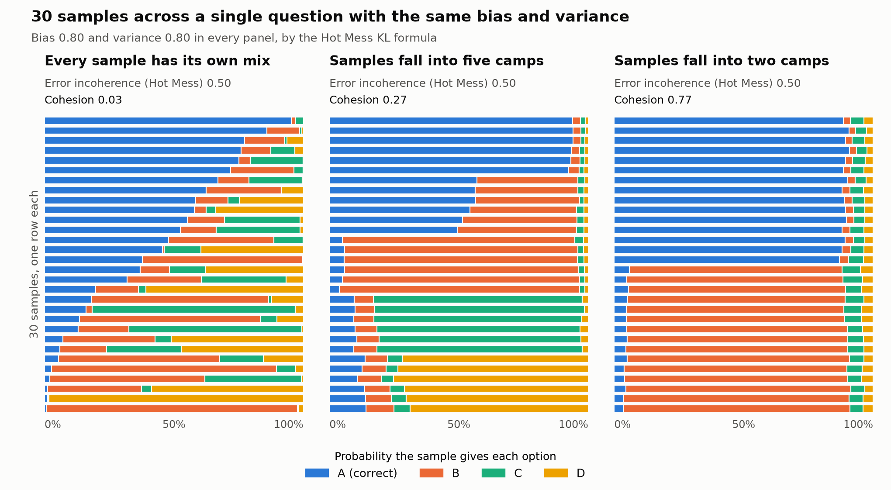

# error-cohesion

A [toy example](toy/README.md) and a [pilot on real data](real/README.md) demonstrating a potential follow-up to the paper [Hot Mess](https://arxiv.org/abs/2601.23045).

> AI can fail because it is misaligned, and produces consistent but undesired outcomes, or because it is incoherent, and does not produce consistent outcomes at all. These failures correspond to bias and variance respectively. As we extrapolate risks from AI, it is important to understand whether failures from more capable models performing more complex tasks will be bias or variance dominated. Bias dominated failures will look like model misalignment, while variance dominated failures will resemble industrial accidents.

The error incoherence measure from this paper assumes that a high incoherence means that the results look like a "Hot Mess" i.e. all the results look inconsistent and random. However, the results can be inconsistent yet still organised. This can be measured using [Cohesion](https://timjdavey.com/cohesion/) ([paper](https://doi.org/10.3390/e25121605) + [package](https://github.com/timjdavey/incoherence))

In terms of the interpretation above, it means that when a system has a high error incoherence and high Cohesion it may well still be considered misaligned (since it's still very consistent in how it's incoherent). And that a "Hot Mess" specifically refers to a system with low Cohesion.

I'd be interested to see how this affects the outcome of incoherence on longer task horizons. As it may well be that in some instances the model falls into a few "attractor" states (from chaos terminology), rather than having an even spread.

The same pattern shows up in the paper's own GPQA runs, see [the real data](real/README.md). And this might lead to better constructions of Cohesion.

The paper's error incoherence also shares a name with [Incoherence](https://doi.org/10.3390/e26080683). They are built for different jobs, see [how they differ](compare/README.md).
