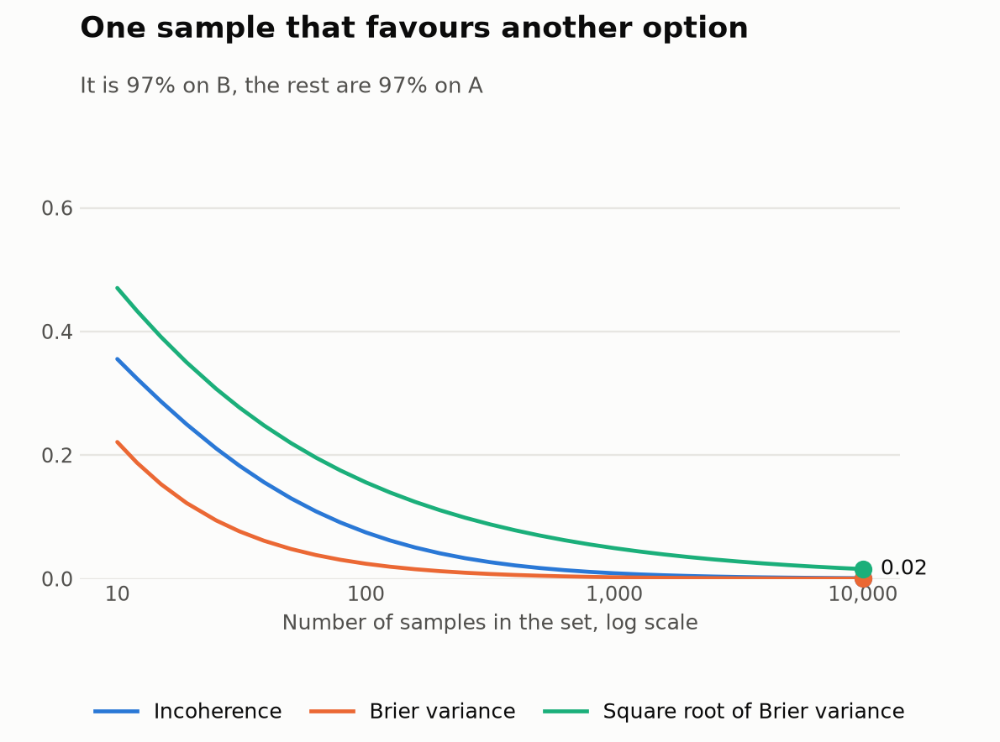
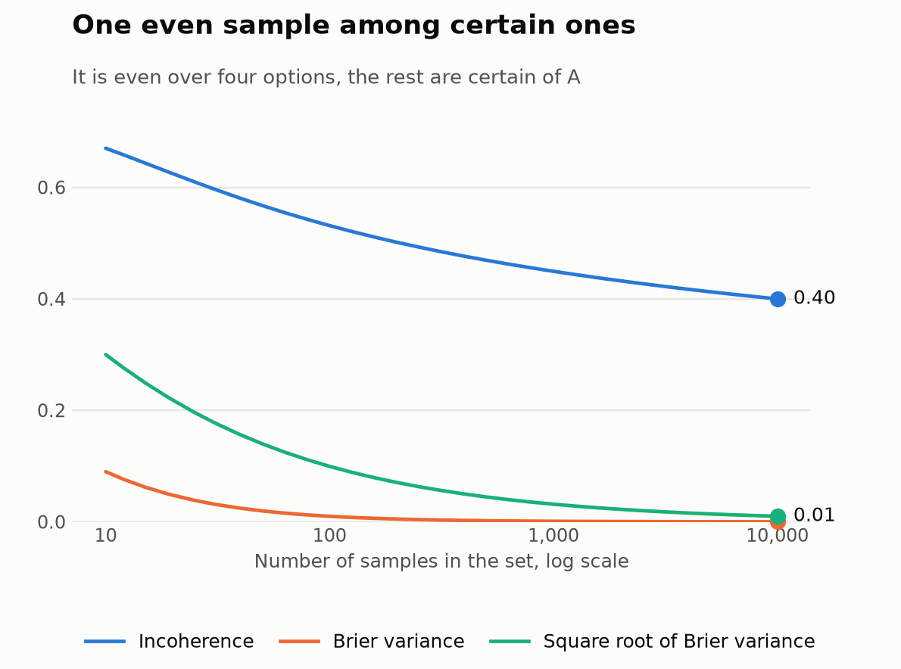

# Incoherence and error incoherence

How Incoherence differs from the Hot Mess paper's error incoherence, shown on toy samples.

- **They share a name and an input, but not a job.** Both read one question asked many times. Error incoherence asks what share of a model's error comes from disagreeing with itself. Incoherence asks how much the answers disagree, and has no idea which answer is right.
- **Neither can stand in for the other.** Incoherence can't see a model that is wrong the same way every time. Error incoherence can't say how much disagreement there is, only its share of the error.
- **Incoherence is nearest to the variance half of error incoherence.** It has three great features that variance lacks. Small doubts in confident answers stand out. Outliers are much more prominent. It has a fixed scale from 0 to 1. See [great features of Incoherence](#great-features-of-incoherence).

## Words used here

Every example is one multiple choice question asked many times.

| Word | What it means |
|---|---|
| Sample | One answer, given as a probability for each option, like "A 97%, B 1%, C 1%, D 1%". The Incoherence paper calls this a trial |
| Set | All the samples from asking one question many times. `ensemble` in code |
| Certain sample | A sample with 100% on one option |
| Confident sample | A sample with 97% on one option and the rest shared evenly |
| Even sample | A sample with the same probability on every option, like 25% on each of four |
| Wobble | Small changes in the probabilities from one sample to the next, like 98% on A in one sample and 90% on A in the next |
| Outlier | A sample unlike the rest of its set, like one even sample among certain ones |
| Entropy | How spread out one sample is across the options. It is 0 for a certain sample and largest for an even one |
| Pool | The plain average of every sample in a set. The Incoherence paper calls it the pooled distribution |
| KL variance, Brier variance | The Hot Mess paper's two ways to score how far the samples are from their average, see [how each is built](#how-each-is-built) |

## What each is for

| | Error incoherence | Incoherence |
|---|---|---|
| Paper | [Hot Mess](https://arxiv.org/abs/2601.23045) (Hägele et al., 2026) | [Incoherence](https://doi.org/10.3390/e26080683) (Davey, Entropy 2024) |
| Question | What share of the error is inconsistency? | Do repeated runs disagree with each other? |
| Built for | Telling misalignment from accident when AI fails | Flagging where an experiment or simulation is unstable |
| Needs the right answer | Yes | No |
| Kind of number | A share of the error | An amount of disagreement, from 0 to 1 |

## How Incoherence reads a set of samples

Incoherence is built from one idea, shown here on two sets of two samples over four options.

| Set of two samples | Entropy of each | Pool | Entropy of the pool | Gap | Incoherence |
|---|---|---|---|---|---|
| Both 97% on A | 0.24 | A 97%, B 1%, C 1%, D 1% | 0.24 | 0.00 | 0.00 |
| One 97% on A, one 97% on B | 0.24 | A 49%, B 49%, C 1%, D 1% | 1.14 | 0.90 | 0.60 |

- **Entropy says how spread out one sample is.** Over four options it is 0 for a certain sample, 0.24 for a confident one and 2 for an even one.
- **Samples that agree pool into what they already were.** The pool is no more spread out than each sample, so the gap between their entropies is 0.
- **Samples that disagree pool into something more spread out.** Neither sample was unsure, but their pool is split between A and B. Its entropy is 1.14, a gap of 0.90.
- **Incoherence is the size of that gap, scaled to run from 0 to 1.** Here it is 0.90 ÷ √(1.14 × 2) = 0.60, where 2 is the largest entropy four options allow.
- **It reads how spread out each sample is, never which option it favours.** A sample that is 97% on A and one that is 97% on B have the same entropy. The second only shows through what it does to the pool.

## How each is built

| Step | Error incoherence | Incoherence |
|---|---|---|
| Average sample | The geometric mean of the samples, scaled to sum to 1 | The pool, which is the plain mean |
| Disagreement | KL variance, which is how far the average is from each sample, taken as a mean | The gap between the pool's entropy and each sample's entropy |
| Final measure | KL variance ÷ (bias + KL variance) | √(mean of gap² ÷ (entropy of the pool × largest entropy)) |
| Reads 0 when | Every sample is the same | Every sample is the same |
| Reads 1 when | The average sample is exactly right, so all the error is variance | Every sample is certain, and together they cover every option evenly |

- **"How far" is scored with the KL divergence.** It is a standard score for how far one sample is from another. It is 0 when they match and has no upper limit. It takes the log of each probability, which matters for [certain samples](#a-fixed-scale-from-0-to-1).
- **Bias is how far the average sample is from the right answer.** It is the KL divergence from the right answer to the average. Incoherence has no such term.
- **The paper also gives a Brier form.** Brier variance is the mean squared distance from each sample to the pool. We divide it by its largest value, 1 − 1 ÷ options, so it runs from 0 to 1.
- **The gap is squared before it is averaged.** A sample can be more spread out than the pool, and that counts as disagreement too.
- **The code is short.** Every measure is a few lines in [`main.py`](main.py).

## Same samples, two readings

Each row is a set of 30 samples over four options, where A is correct.

The wobble rows start with every sample at 97% on one option, then nudge each sample at random. The samples end up with between 77% and 99% on that option. Two of them are "A 97%, B 1%, C 1%, D 1%" and "A 91%, B 2%, C 5%, D 3%".

| Set of samples | Bias | KL variance | Error incoherence | Incoherence |
|---|---|---|---|---|
| Always 97% on A | 0.03 | 0.000 | 0.00 | 0.00 |
| Always 97% on B | 4.61 | 0.000 | 0.00 | 0.00 |
| Near 97% on A, with a wobble | 0.03 | 0.034 | 0.53 | 0.32 |
| Near 97% on B, same wobble | 4.60 | 0.034 | 0.01 | 0.32 |
| Two camps, half 97% on A and half 97% on B | 0.79 | 1.528 | 0.66 | 0.60 |

- **A steady wrong answer scores 0 on both, and means two things.** Error incoherence says all the error is bias. Incoherence says nothing varies, and it can't tell the second row from the first.
- **The same wobble is half the error or none of it.** The two wobble rows are the same samples with A and B swapped. Incoherence reads 0.32 for both. Error incoherence reads 0.53 when the model is right and 0.01 when it is wrong, because bias grew from 0.03 to 4.60.
- **Two camps score high on both.** Whether disagreement falls into camps is a third question, which [Cohesion](../toy/README.md) answers.

## Great features of the Hot Mess measures

- **They see bias.** Incoherence reads 0 for a model that is always wrong, as the [first table](#same-samples-two-readings) shows.
- **Error incoherence gives a share.** It says whether inconsistency is most of what a model gets wrong or a sliver of it. Incoherence has no error to take a share of.
- **Brier variance sees which option a sample favours.** Incoherence reads each sample through its entropy. A sample that is 97% on B has the same entropy as one that is 97% on A, 0.24. So it only shows through its small effect on the pool.

The table below shows that last feature at work. One sample favours B and the rest favour A. The first two columns use confident samples, at 97%, and the chart shows these. The last two use certain samples.

| Number of samples | Incoherence, confident | Root of Brier variance, confident | Incoherence, certain | Root of Brier variance, certain |
|---|---|---|---|---|
| 10 | 0.355 | 0.470 | 0.484 | 0.490 |
| 100 | 0.075 | 0.156 | 0.201 | 0.162 |
| 1,000 | 0.009 | 0.050 | 0.076 | 0.052 |
| 10,000 | 0.001 | 0.016 | 0.027 | 0.016 |

- **With confident samples, Incoherence falls faster than the root of Brier variance.** At 1,000 samples it reads 0.009 against 0.050. The pool's entropy is 0.248 there, barely above the 0.242 of each sample.
- **With certain samples, it keeps up.** It reads 0.076 against 0.052. Certain samples have no entropy of their own, so all of the pool's entropy counts as disagreement.

## Great features of Incoherence

Error incoherence is built from bias and variance, and only bias uses the right answer. So the fair thing to compare Incoherence with is the variance, in both its forms.

### Small doubts in confident answers stand out

A model that slips from 98% to 90% sure gives the other option five times the chance, 2% to 10%. Incoherence treats that as a real change. Brier variance scores it the same as 54% sliding to 46%, which swaps one near coin toss for another.

Two samples over two options, 8 percentage points apart in both rows.

| Pair of samples | Entropy of each | Entropy of the pool | Incoherence | KL variance | Brier variance |
|---|---|---|---|---|---|
| Nearly certain, 98% on A and 90% on A | 0.141 and 0.469 | 0.327 | 0.289 | 0.016 | 0.0064 |
| Nearly even, 54% on A and 46% on A | 0.995 and 0.995 | 1.000 | 0.005 | 0.003 | 0.0064 |

- **Incoherence reads the nearly certain pair about 60 times higher.** The left chart shows why. Entropy is steep near 100% and flat near 50%. The same 8 points move it from 0.14 to 0.47 in the first pair and not at all in the second.
- **Brier variance can't tell the rows apart.** The wobble is the same size, so it reads 0.0064 for both.
- **KL variance sees the difference too, but less.** It reads the nearly certain pair about 5 times higher, 0.016 against 0.003.
- **The scaling adds a little more.** Incoherence divides by the pool's entropy, which is 0.327 for the first pair and 1.000 for the second. On its own that is worth about 1.7 times, √(1 ÷ 0.327).
- **This is by design.** A wobble in a system that looks settled is the surprise worth flagging. The cost is that Incoherence does not count the favoured option changing in the second pair, as [great features of the Hot Mess measures](#great-features-of-the-hot-mess-measures) shows above.

### Outliers are much more prominent

One sample is even over four options, and so is an outlier. The rest are certain of A. Incoherence is a square root, so the table shows the root of Brier variance too.

| Number of samples | Entropy of the pool | Incoherence | Brier variance | Root of Brier variance |
|---|---|---|---|---|
| 10 | 0.503 | 0.670 | 0.0900 | 0.300 |
| 100 | 0.076 | 0.531 | 0.0099 | 0.099 |
| 1,000 | 0.010 | 0.449 | 0.0010 | 0.032 |
| 10,000 | 0.001 | 0.400 | 0.0001 | 0.010 |

- **Incoherence falls from 0.67 to 0.40.** One outlier in 10,000 still reads clearly.
- **Brier variance falls tenfold each time the samples grow tenfold.** By 10,000 samples the outlier has vanished. The square root does not save it, since that falls to 0.010.
- **The scaling is why.** Brier variance is scaled by a fixed largest value. Incoherence is scaled by the pool's entropy, which falls nearly as fast as the outlier's share. A set this settled has almost no spread, so one outlier is most of it.
- **It does still fall, slowly.** It reads 0.338 at a million samples.

### A fixed scale from 0 to 1

Every sample here is certain, which is what you get when you record only the answer a model picked on each run. KL variance takes the log of each probability, and the log of 0 has no value. So we add a small number to every probability first, and the two KL columns use different small numbers.

| Set of certain samples | Incoherence | Brier variance, before scaling | KL variance, adding a millionth | KL variance, adding a trillionth |
|---|---|---|---|---|
| 2 options, one sample on each | 1.000 | 0.500 | 6.2 | 13.1 |
| 4 options, one sample on each | 1.000 | 0.750 | 9.0 | 19.3 |
| 64 options, one sample on each | 1.000 | 0.984 | 9.4 | 23.0 |
| 4 options, two samples on two of them | 0.707 | 0.500 | 6.2 | 13.1 |
| 4 options, three samples on A and one on B | 0.637 | 0.375 | 3.5 | 6.9 |

- **KL variance is set by the small number, not the samples.** It about doubles when the number changes from a millionth to a trillionth, and it has no upper limit.
- **Incoherence reads 1 at any number of options.** Brier variance reads 0.500, 0.750 and 0.984 for the same three sets, and needs our scaling to read 1.
- **Unused options lower Incoherence.** Two certain samples that use two of four options score 0.707, not 1.

## Which to use when

| You want to know | Use |
|---|---|
| Whether failures look like misalignment or accident, and you have the right answers | Error incoherence |
| Whether repeated runs disagree, with no right answer to hand | Incoherence |
| Whether a system that looks settled has a rare odd run | Incoherence |
| How far apart the answers are, counting which option each one favours | Brier variance |
| Whether the disagreement falls into camps | [Cohesion](../toy/README.md) |

## Run it

You need [uv](https://docs.astral.sh/uv/). Run these from the repo root.

| What | Command |
|---|---|
| Print every number above | `uv run compare/main.py` |
| Redraw the four figures in `compare/` | `uv run compare/plot.py` |

## Limitations

- **Nothing about real models.** Every sample is made up to show how the measures behave.
- **The comparison is ours.** Neither paper compares the two measures.
- **Two choices are ours, not the Hot Mess paper's.** They are the scaling of Brier variance and the small number we add before taking logs. The formulas come from the paper.
- **Nothing about continuous data.** Incoherence also reads real-valued observations. The Hot Mess paper uses squared distance for those, and we have not compared them.
