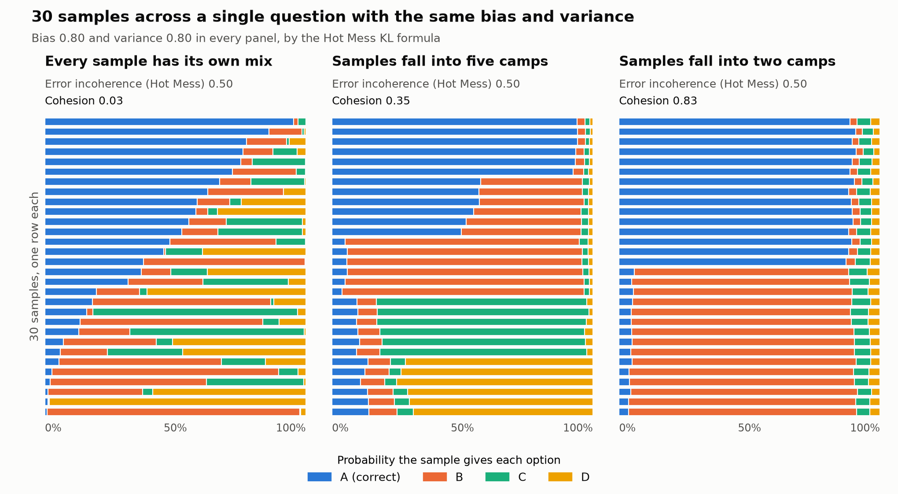

# The toy

Three toy sets of samples that share the same Hot Mess error incoherence but behave differently. We look at how Cohesion acts.

## The setup

- **One multiple choice question is asked 30 times.** It has four options, and A is correct.
- **Each answer is four probabilities, one per option.** For example "A 60%, B 30%, C 8%, D 2%". We call each of these a sample.
- **The [Hot Mess paper](https://arxiv.org/abs/2601.23045) splits a model's error into two parts.** Bias is how far the average sample is from the right answer. Variance is how far the samples are from their own average.
- **Error incoherence is the share of the error that is variance.** It is variance ÷ (bias + variance). The paper labels the bias term "Bias²", but in the KL form it is the KL itself, so nothing is squared. A high score means the model is wrong mostly because it disagrees with itself.
- **The paper sums over many questions.** Its error incoherence is total variance ÷ total error across a question set. With one question, as here, that is the same ratio.

These are not real results from a model. The distributions were picked specifically to hold error incoherence steady while altering Cohesion.

## Three sets of samples with the same score

Each panel is one set of 30 samples, with one row per sample. The colours show how much probability the sample gave each option.

| Samples | Bias | Variance | Error incoherence | Incoherence | Cohesion |
|---|---|---|---|---|---|
| Every sample has its own mix | 0.80 | 0.80 | 0.50 | 0.42 | 0.03 |
| Five camps | 0.80 | 0.80 | 0.50 | 0.55 | 0.35 |
| Two camps | 0.80 | 0.80 | 0.50 | 0.41 | 0.83 |

- **The three Hot Mess numbers are the same in every row.** We built the samples that way, see [how the toy is built](#how-the-toy-is-built).
- **The behaviour is not the same.** On the left, no two samples agree. On the right, every sample is one of two answers, "mostly A" (about 89%) or "mostly B" (about 85%).
- **Cohesion rises as the samples form fewer and clearer camps.** It reads 0.03, then 0.35, then 0.83.
- **Two camps is not a mess.** It looks like two steady behaviours that the model switches between. That is a different problem from answers with no pattern at all.

## The two extra measures

Both come from the [incoherence](https://github.com/timjdavey/incoherence) package. Both run from 0 to 1, and neither uses the correct answer as an input. Incoherence is not the same thing as error incoherence, see [how they differ](../compare/README.md).

Cohesion uses the package default `k`, 8 for each sample, so 240 here and 320 for the 40 runs in [the real data](../real/README.md). The Cohesion paper fixed it at 100, which gives lower readings.

| Measure | What it says | Paper |
|---|---|---|
| Incoherence | How much the samples disagree with each other | [Entropy, 2024](https://doi.org/10.3390/e26080683) |
| Cohesion | Whether that disagreement falls into a pattern, such as camps | [Entropy, 2023](https://doi.org/10.3390/e25121605) |

## Run it

You need [uv](https://docs.astral.sh/uv/). It installs everything else the first time you run a command. Run these from the repo root.

| What | Command |
|---|---|
| Print the table above | `uv run toy/main.py` |
| Redraw the figure to `toy/figure.png` | `uv run toy/plot.py` |
| Repeat over 20 seeds and five levels of variance | `uv run toy/main.py --sweep` |

## How the toy is built

- **Bias matches because every set has the same mean prediction.** The paper's mean prediction is the normalised geometric mean of the samples, not the plain average. The samples in each set are spread around one centre in log space, so every set has a mean prediction of "A 45%, B 35%, C 12%, D 8%". The plain averages differ, for example about 47%, 44%, 6% and 4% for two camps.
- **Variance matches because we scale the spread.** Each set is stretched or squeezed until its variance is 0.80.
- **Only the shape of the spread differs.** One set is a cloud, one has five camps and one has two.
- **The formulas are the paper's KL form.** They are in `hot_mess()` in [`measures.py`](../measures.py), and its docstring gives the detail.

## Does it hold at other scores?

Yes, with one limit. This table shows the mean Cohesion over 20 seeds at five levels of error incoherence. "Own mix" is the cloud version. The figure uses one seed, so its numbers can differ a little.

| Error incoherence | Own mix | Five camps | Two camps |
|---|---|---|---|
| 0.11 | 0.63 | 0.73 | 0.90 |
| 0.24 | 0.32 | 0.50 | 0.86 |
| 0.39 | 0.11 | 0.37 | 0.83 |
| 0.50 | 0.03 | 0.35 | 0.84 |
| 0.65 | 0.00 | 0.46 | 0.88 |

- **The order holds at every level.** Two camps always scores highest and own mix always scores lowest.
- **The gap is wide from 0.39 upwards.** Own mix reads 0.11 or less, and two camps reads 0.83 or more.
- **The gap narrows when variance is small.** At an error incoherence of 0.11, own mix reads 0.63 against 0.90 for two camps. With little disagreement every pair of samples is close, so the pairwise gaps bunch near zero whatever the shape.
- **The last row is partly the certainty effect.** At 0.65, about 40% of the two-camp and five-camp samples put over 95% on one option. That pushes Cohesion up, as described under Limitations, and is likely why five camps rises from 0.35 to 0.46.

## Limitations

- **Nothing about real models.** Every sample is made up to prove a point about the measure.
- **Nothing for answers that are fully certain.** If every sample puts 100% on one option, any two samples either match or fully differ. Cohesion then reads about 0.94 whether the answers use two options or all four.
- **Nothing about the right answer.** Cohesion ignores which option is correct. A version that uses it is an open question. It's likely Cohesion stays a sister metric alongside incoherence and error incoherence.
